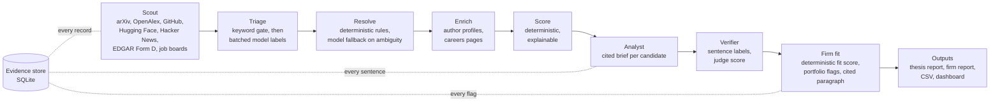
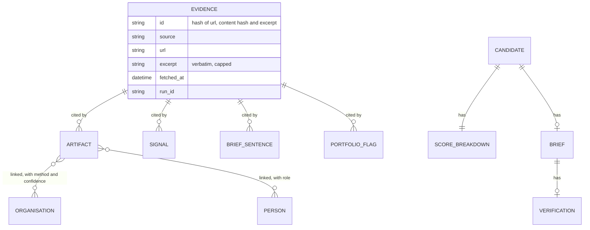
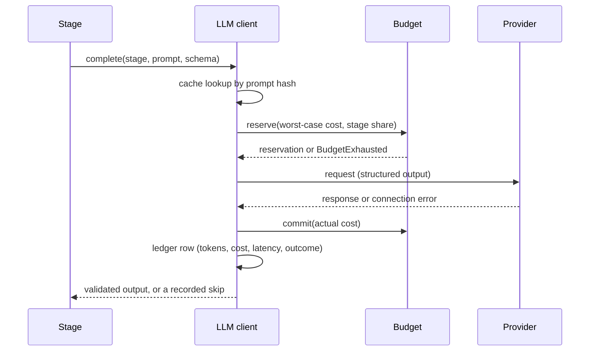

# Architecture

Headwater is a venture sourcing agent: it collects public artifacts, resolves them to the
people and organisations behind them, ranks candidates with a deterministic score, and uses
language models only where judgement is needed, under hard budget caps, with every claim tied
to an Evidence record. This document is the engineering overview; the numbers are in
`EVALUATION.md` and the data rules in `DATA_POLICY.md`.

## The pipeline



Each stage is a function over a `RunContext` (settings, thesis pack, firm profile, store,
HTTP client, LLM client, budget, run id). A run is a `run_id` that ties logs, Evidence,
model calls, candidates and reports together; its summary records the funnel, the sources
that answered or failed, the cost per stage, the verification rate, budget stops and every
failure. The design mirrors the "observe, decide, act, improve" loop: Scout and Triage
observe, Resolve and Score decide, Analyst and Firm fit act, Verifier and the evaluation
suite improve.

## What the models do, and do not do

| Stage | Model | Decides | Never decides |
|---|---|---|---|
| Triage | small, batched | whether an artifact is relevant, adjacent or irrelevant to a thesis | the ranking |
| Resolver fallback | mid-size | whether two ambiguous records are the same entity, citing evidence | merges below a confidence bar (those go to a review queue) |
| Analyst | large | the brief: what they are building, why now, signals, risks, questions, every fact cited | anything not in the evidence packet |
| Verifier | a different model | whether each sentence is supported, unsupported or contradicted by its citations; a rubric score | rewriting (unsupported sentences are removed, not fixed) |
| Firm fit | large | the fit paragraph and portfolio conflict or adjacency flags, citing evidence and the firm's own statements | the fit score (deterministic) |

Every call is routed by stage from one configuration file, estimated before it is sent,
charged after, cached by prompt hash, and stopped gracefully when the run's cap would be
exceeded; skipped work is recorded in the run summary.

## Evidence



An Evidence record is immutable: the source, the URL, a verbatim excerpt, the content hash
and the fetch time. The store enforces the foreign key from every Artifact, Signal, Brief
sentence and flag to an Evidence id; the report renderer refuses to print a sentence whose
evidence it cannot find. If it is not in Evidence, it does not exist.

## Scoring

The score is a weighted sum of six components, each between 0 and 1 and each carrying its
own explanation and the ids of the evidence behind it:

- **momentum**: growth of stars, downloads, launch attention and hiring, z-scored against a
  robust baseline of the run's own candidates; without a time series the component is
  level-only and says so;
- **founder quality**: anchor affiliations, citation growth, shipped open source;
- **formation**: a first Form D filing, a first job posting, organisation age;
- **thesis fit**: the share of relevant artifacts and the pack's keyword coverage;
- **consensus penalty**: incumbency and crowd signals that make a candidate obvious;
- **integrity**: completeness and consistency of the record.

The weights are a versioned configuration; the repository ships illustrative defaults and a
firm's tuned weights stay private. Candidates are organisations with at least one relevant
artifact in the window, or pre-formation people with a relevant artifact and no company,
minus anchors and academic organisations. Incremental weekly runs collect only what is new
and re-score the full window; a brief is regenerated only when a candidate is new or has
moved.

## Firm layer

A firm profile is built from the firm's own public pages: thesis statements kept only when
they appear verbatim in the cited page, portfolio companies named on a page, stages and
cheque size as written. Each portfolio company is then researched independently (the firm's
sub-page, Wikidata, launch posts, GitHub, a guessed domain), verified by name on its own site,
and its facts kept only as quotes or substrings of the cited page. From the researched
portfolio the engine derives an observed investment pattern and the pack weights the
portfolio implies, shown next to the firm's stated weights. Fit is deterministic: score as a
share of the pack's best, times the firm's weight for the pack, discounted outside the firm's
stage. Flags start deterministic (a portfolio company named in the evidence) and the model may
re-label or add flags only for listed companies, with citations.

## Reliability and budgets



Network failures are first-class: connection errors trip a breaker in the model client after
two in a row, the HTTP client opens a breaker after six consecutive network errors and
probes once a minute, a TCP canary tells a dead network from a host that does not answer,
and long passes checkpoint their work and resume. Every stop is written to the run summary.

## Confidentiality

The core repository is private. A generated showcase contains only allowlisted documents
and marked code excerpts, and is refused if a leak check finds a private file, a secret, a
private weight, prompt text, a firm name, personal data or too much of any module. A static
demo site is built from precomputed outputs with no backend, `noindex`, a disallow-all
`robots.txt`, minified scripts and a watermark when it is built for a firm.

## Repository layout

```
src/headwater/
  sources/      one module per public source, rate limits and caching
  resolver/     deterministic rules and ambiguous cases
  scoring/      features, components, baselines
  agents/       triage, resolver fallback, analyst, verifier, evidence packets
  firmfit/      profile builder, portfolio research, strategy, fit
  report/       thesis and firm reports (Markdown, HTML, PDF)
  evaluation/   backtest, sanity, precision flow, reliability tests
  dashboard/    Streamlit pages over tested queries
  showcase/     allowlisted showcase, leak check, static demo site
  llm/          routing, cache, budget, ledger, providers
  http/         client with cache, record and replay, breakers
  store/        SQLite with Evidence foreign keys
config/         thesis packs, model routing, illustrative weights
private/        firms, prompts, tuned weights (never shared)
eval/           labelled fixtures and results
```
